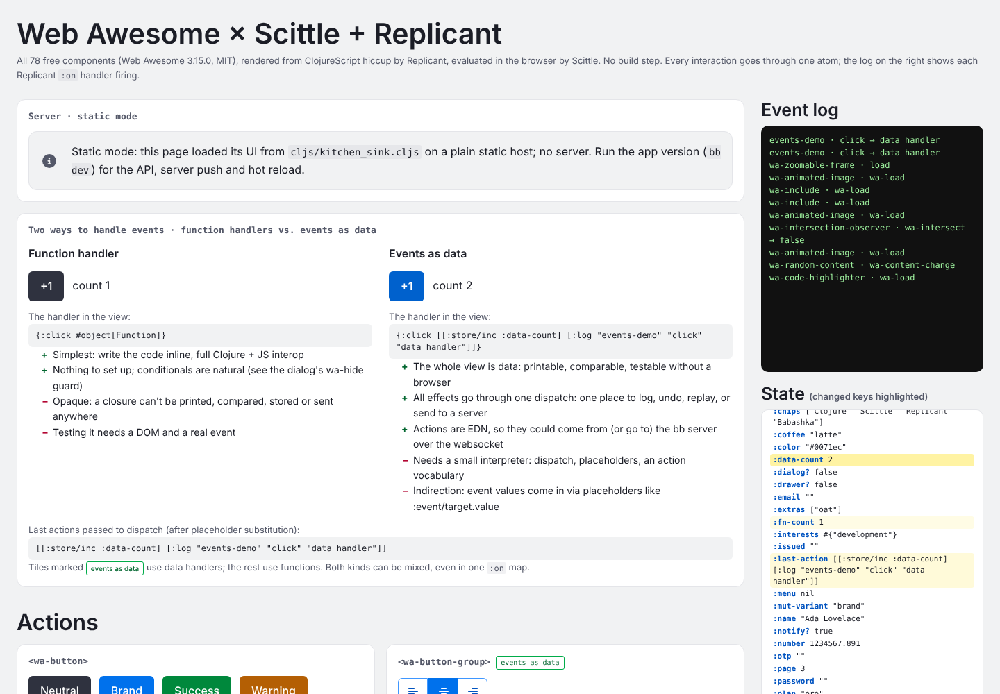
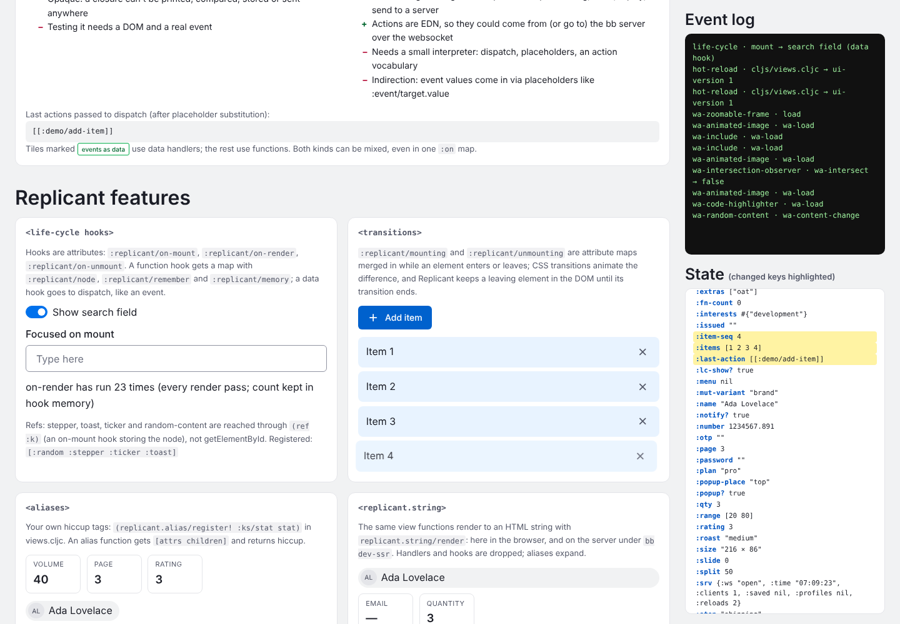
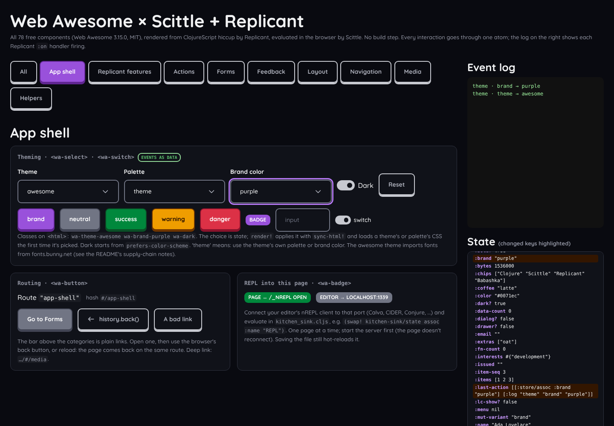

# Scittle × Replicant × Web Awesome — GUI kitchen sink

**Live demos:** [single file](https://franks42.github.io/scittle-replicant-webawesome-kitchensink/single-file/) · [HTML + separate .cljs](https://franks42.github.io/scittle-replicant-webawesome-kitchensink/app/public/static.html)  
**Guide:** [docs/GUIDE.md](docs/GUIDE.md) (also on the site: [GUIDE.html](https://franks42.github.io/scittle-replicant-webawesome-kitchensink/docs/GUIDE.html))
**For AI coding assistants:** [skills/scittle-replicant-webawesome/SKILL.md](skills/scittle-replicant-webawesome/SKILL.md), a short, directive skill (template, rules, event table, traps, verification); `docs/GUIDE.md` is the long version with the reasoning and test evidence.

Browser UIs in ClojureScript **without React, a bundler, or a build step**:

- **[Scittle](https://github.com/babashka/scittle)** evaluates ClojureScript in the browser.
- **[Replicant](https://github.com/cjohansen/replicant)** renders hiccup to the DOM (loaded as a Scittle plugin).
- **[Web Awesome](https://webawesome.com)** provides the components: all 78 free ones (3.15.0, MIT) are exercised here.


## What this is (and isn't)

This is a **kitchen-sink demo**: one page that puts every free Web Awesome component on screen, wires each interactive one to a single ClojureScript atom, and logs every event it handles. Its job is to show, by running code, that the stack works and *how* each component is driven: which attribute to set, which event to listen for, where the value lives in the event.

It is **not a library and not a starter app you should ship as-is.** Treat it as a template you adapt once you understand it:

1. Run it, click around, and watch the **Event log** and **State** panels on the right (see below). Every interaction is a Replicant `:on` handler doing a `swap!` on one atom, and the two panels show you both halves of that.
2. Read `app/public/cljs/kitchen_sink.cljs` with the page open (see *What to look for* below).
3. Copy the parts you need into your own project and delete the rest (see *Using it as a template*).

## Watch the Event log and State panels

The two panels on the right are the best way to learn how the page works. Click, type or drag anything and watch both:

- **Event log** (newest first, last 200 events, scrollable): which handler fired and with what value, e.g. `wa-button-group · select → right` or `wa-dialog · wa-hide`. That tells you which DOM event a component emits and what you read from it.
- **State** (one row per key, sorted, scrollable): the whole app state, with the keys the last `swap!` changed **highlighted for two seconds**; if a changed key is scrolled out of view, the panel scrolls to it. That tells you exactly what your handler changed.

Both panels sit in a column that stays fixed beside the page and is exactly one screen high, so you can scroll to any component and still see the log and the state while you use it.

So every interaction shows the full loop: **event → handler → `swap!` → changed keys → re-render**. In the screenshot above, clicking the right-align button logged `select → right` and highlighted `:align "right"`.

Things you'll notice while the page sits idle are real state changes, not noise:

- In app mode `:srv` lights up every 5 s: that's the server pushing a `:tick` over the websocket.
- `:size` changes once right after load, when the resize-observer demo first measures its box.

Both panels are ordinary code you can keep in your own app while developing: `log!`, `state-panel` and `note-change!` in `kitchen_sink.cljs`.

## Two ways to handle events: functions or data

Replicant gives you two kinds of event handler, and the kitchen sink shows both. The **"Two ways to handle events"** tile at the top runs the same counter both ways side by side; tiles marked **events as data** (button group, coffee select, notifications switch, volume slider, tabs, pagination) use data handlers, the rest use functions.

```clojure
;; 1. Function handler: Replicant calls the function with the DOM event
[:wa-switch {:on {:change #(swap! state assoc :notify? (.. % -target -checked))}}]

;; 2. Events as data: Replicant passes this vector, untouched, to the one
;;    function registered with replicant.dom/set-dispatch!
[:wa-switch {:on {:change [[:store/assoc :notify? :event/target.checked]
                           [:log "wa-switch" "change" :event/target.checked]]}}]
```

How the data path works here (`kitchen_sink.cljs`, section *Events as data*):

1. Replicant sees a handler that isn't a function and calls `dispatch!` with the event data and the vector.
2. `interpolate` replaces placeholders such as `:event/target.checked` or `:event/detail.name` with values from the DOM event (`clojure.walk/postwalk`).
3. `apply-action` (in `logic.cljc`) is a **pure reducer** `(state, action) -> state`; all actions of one event are applied in a **single `swap!`**, so one event is one state transition, and the State panel highlights everything it changed.
4. The applied actions are kept in `:last-action`, so you can watch the data that went through.

| | Function handlers | Events as data |
|---|---|---|
| Setup | none | a dispatch function, placeholder substitution, a small action vocabulary |
| Writing a handler | inline Clojure, full interop, conditionals are natural | pick actions; event values via placeholders |
| What the view contains | `{:click #object[Function]}`, opaque | `{:click [[:store/inc :data-count] …]}`, plain data |
| Testing | needs a DOM and a real event | assert on the view's data, and unit-test `apply-action` with plain maps (`bb test` does) |
| Logging, undo, replay | add it to every handler | one place: the dispatch function |
| Crossing the wire | closures can't be serialized | actions are EDN: could come from, or be sent to, the bb server |
| Best for | one-offs, interop-heavy or conditional logic (e.g. the dialog's `wa-hide` guard) | most UI state changes, especially as an app grows |

They mix freely, even within one `:on` map, so you can start with functions and move handlers to data as patterns repeat.



## Replicant features: hooks, transitions, aliases, string rendering

The **Replicant features** section at the top of the page covers the rest of Replicant's toolbox, one tile each:

| Feature | What the tile shows | Where in the code |
|---|---|---|
| **Life-cycle hooks** | `:replicant/on-mount` focusing an input (function hook); `on-mount`/`on-unmount` as **data** hooks that go through `dispatch!` like events; `on-render` with `:replicant/remember` / `:replicant/memory` (state kept on the DOM node, not in the atom); **refs**: the stepper, toast, ticker and random-content nodes are captured by an `on-mount` hook (`(ref :k)`) instead of `getElementById` | `ref`, `refs`, `replicant-features` in `kitchen_sink.cljs` |
| **Transitions** | `:replicant/mounting` / `:replicant/unmounting` attribute maps animated by CSS: items slide in, and slide out before Replicant removes them | the `transitions` tile; `.tr-item` CSS |
| **Aliases** | your own hiccup tags: `[:ks/stat {:label "Volume"} 40]`, `[:ks/chip ...]`, registered with `replicant.alias/register!`; the tile shows what an alias expands to | `views.cljc` |
| **String rendering** | `replicant.string/render` turns the same view into HTML, live as you edit the form; handlers and hooks are dropped, aliases expand | the `replicant.string` tile |

Facts measured while building this (Scittle 0.8.33 bundles Replicant 2026.06.2): a data life-cycle hook reaches the dispatch function with **two** arguments (`:replicant/trigger` = `:replicant.trigger/life-cycle`); `on-render` fires on **every** render pass, not only when its element changes; an unmounting element stays in the DOM until its CSS transition ends. Don't change state from an `on-render` data hook (it would loop); the kitchen sink applies life-cycle actions after the current render.

### One view, two renderers: server-side rendering

`app/public/cljs/views.cljc` holds interop-free views (`profiles-table`, `profile-card`) and the alias functions (as a plain `aliases` map; whoever renders registers them). The browser loads it with Scittle; the bb server can load **the same file** and render it with `replicant.string`:

```bash
bb dev-full     # app server + Replicant and sci.nrepl on the server's classpath (app/dev-full.edn)
open http://localhost:8090/ssr/profiles
```

`bb dev-full` resolves its two dependencies (Replicant 2026.06.2, the version Scittle bundles, and sci.nrepl for the REPL below) through babashka's `:deps`, which needs a **Java runtime the first time**; plain `bb dev` stays dependency-free and answers `/ssr/profiles` with a 501 that says how to enable it. Editing `views.cljc` hot-reloads it in the browser like any `.cljs` file, and the next `/ssr/profiles` request re-reads it.



## App shell: theming, routing, validation, a REPL, unit tests

The pieces a real app adds around the components. The first four are tiles in the **App shell** section (and the profile form); all are driven from the same state atom, and all are covered by the tests.

**Theming and dark mode.** The Theming tile picks a Web Awesome theme (default, awesome, shoelace), a color palette, a brand color and dark mode. The choice is state (`:theme :palette :brand :dark?`); `render!` calls `sync-html!`, which turns it into classes on `<html>` (`logic/html-classes`, e.g. `wa-theme-awesome wa-brand-purple wa-dark`) and loads a theme's or palette's CSS file from the same pinned Web Awesome build the first time it's picked. `:dark?` starts from `prefers-color-scheme` (Web Awesome doesn't detect it itself). The page's own CSS uses theme variables, so the Event log and State panels follow dark mode too.

**Form validation, one set of rules for browser and server.** `logic/validate-profile` returns `{field message}`: name required, email well-formed, **email required when quantity is over 5** (a cross-field rule no HTML attribute can express), quantity 0–10. The form puts each message on its field with Web Awesome's `custom-error` attribute (`nil` removes it), so the browser blocks the submit, the field shows as invalid and `wa-invalid` fires (logged, as data handlers). No hooks, no `setCustomValidity` calls: the error state is just another attribute computed from state. The server runs the **same function** on `POST /api/profile` and answers 400 with the same messages; switch off *Validate in the browser* (sets `novalidate`) and the form shows the server's 400 instead.

**Routing.** The URL hash is the source of truth: the bar above the categories is plain links (`#/forms`), the browser updates location and history, and one `hashchange` listener puts the parsed route into state (`:route`); the view shows the matching category. Back, forward, reload and shared deep links (`…/static.html#/media`) work, unknown routes get a "no page" callout, and it needs no server support, so it works on GitHub Pages, in the single file and from `file://`-free static hosts alike. The History API (`/forms`) would give cleaner URLs but needs a server that answers every path with the page.

**A REPL into the running page.** Under `bb dev-full` the server also starts [sci.nrepl](https://github.com/babashka/sci.nrepl)'s browser nREPL: an nREPL server on `localhost:1339` for your editor, while the page side is a websocket the app server itself serves at `/_nrepl` (same port, same origin, guarded; see *Supply chain and security*). The page asks `GET /api/dev-info`, sees the nREPL, and loads `scittle.nrepl.js`, which connects to `/_nrepl`; the REPL tile shows the connection. Connect any nREPL client (Calva, CIDER, Conjure, …) to port 1339 and evaluate in `kitchen_sink.cljs`, e.g. `(swap! kitchen-sink/state assoc :name "REPL")`; the page updates. Limits: one page at a time, start the server before opening the page (the page doesn't reconnect).

**Unit tests without a browser.** The reducer, routing, theming and validation logic live in `app/public/cljs/logic.cljc`: no DOM, no interop, no dependencies. `views.cljc` is the same. So babashka loads both files, unchanged, and tests them as plain functions:

```bash
bb test        # test/unit_test.clj: reducer, routing, theming, validation, views - no Java, no browser
```

Views are tested as data: `profiles-table` returns hiccup, and the test walks it (rows keyed by id, aliases used, alias functions expanding to plain hiccup). That's the payoff of keeping logic and views pure: the browser suite checks the wiring, `bb test` checks the logic in under a second.



## Architecture

```
 Browser                                                     Server (app mode only)
 ───────────────────────────────────────────────────         ───────────────────────────────
 HTML shell (index.html / static.html)                       app/server.clj  (babashka + http-kit)
   ├─ <link> Web Awesome CSS ─┐                                ├─ GET  /…            static files
   ├─ <script> WA autoloader ─┤ pinned jsdelivr URLs           ├─ POST /api/profile  EDN in/out
   ├─ <script> Scittle ───────┤ (no npm, no bundler)           ├─ GET  /api/profiles EDN out
   ├─ <script> Replicant plugin                                ├─ /ws  websocket: :tick, :reload
   └─ <script type="application/x-scittle"                     └─ watcher: .cljs changed → :reload
             src="cljs/kitchen_sink.cljs">
                 │
                 ▼  Scittle interprets the ClojureScript
   (defonce state (atom {...}))  ◄────────────────────────┐
                 │ add-watch → render!                    │ swap!
                 ▼                                        │
   (view @state) → hiccup → replicant.dom/render          │
                 │                                        │
                 ▼                                        │
   <wa-input> <wa-select> <wa-dialog> …  ── events ──► :on handlers
                                                       (fn → swap!, or data → dispatch! → reduce actions → swap!)
   (Web Awesome custom elements; Lit renders their
    insides in shadow DOM; your code never touches Lit)
```

- **One atom, one render loop.** All UI state is in `state`; `add-watch` re-renders the whole view on every change (and records which keys changed, for the State panel). Replicant diffs and updates only what changed in the DOM.
- **Views are plain functions returning hiccup.** No component framework, no lifecycle; `(view s)` is pure data in, data out.
- **Web Awesome components are just HTML elements.** Replicant sets their attributes/properties and attaches native listeners, so standard events (`input`, `change`) and custom ones (`wa-hide`, `wa-tab-show`, …) work the same way.
- **Handlers are functions or data.** A function handler calls `swap!` itself; a data handler (a vector of actions) goes through `dispatch!`, which applies it to the state with a pure reducer in one `swap!`. See *Two ways to handle events*.
- **The server is optional.** The whole left column of the diagram runs on any static host; the bb server on the right adds an API, push messages and hot reload.

## The three modes

The same `kitchen_sink.cljs` runs in three ways. The HTML page picks the mode by setting `window.KS_MODE` before the Scittle script runs; the cljs reads it into `mode`, `single?` and `server?`:

| | **single** | **static** | **app** (default) |
|---|---|---|---|
| Page | `single-file/index.html` | `app/public/static.html` | `app/public/index.html` |
| How the cljs arrives | inlined in the HTML | fetched: `<script src="cljs/kitchen_sink.cljs">` | fetched, same file |
| Assets (images, include, page-demo) | embedded as `data:` URLs / `srcdoc` | relative files next to the page | relative files, served by bb |
| Needs | any static host | any static host | `bb dev` |
| Server features | none | none | EDN API, websocket push, hot reload |
| Use it to | hand someone one working file | keep the UI in a real `.cljs` file, host anywhere (e.g. GitHub Pages) | grow into a real web app |
| Live | [GitHub Pages](https://franks42.github.io/scittle-replicant-webawesome-kitchensink/single-file/) | [GitHub Pages](https://franks42.github.io/scittle-replicant-webawesome-kitchensink/app/public/static.html) | your machine / server |

`app/` is the source of truth. `single-file/index.html` is **generated** from it by `bb build-single` (inlines the cljs, embeds the assets); never edit it by hand. GitHub Pages serves this repo from `main`, so after changing `app/`, run `bb build-single` and commit the regenerated file to update the live demo.

## What to look for

In `app/public/cljs/kitchen_sink.cljs`, top to bottom:

| Where | What it shows |
|---|---|
| `mode`, `single?`, `server?`, `asset` | How one file adapts to three deliveries (mode flag + asset indirection). |
| `;; State + helpers`: `state`, `log!`, `on!`, `tile` | The single atom, the event log, a handler helper (`(on! :name tv)` = "store this field's value"), and a layout helper. |
| `logic.cljc`: `apply-action`, `parse-route`, `html-classes`, `validate-profile` | Pure logic shared by the browser, the server and `bb test`: the reducer, routing helpers, theme classes, the validation rules. |
| `views.cljc`: `stat`, `chip`, `aliases`, `profile-card`, `profiles-table` | Interop-free views shared with the server; alias functions as a plain map. |
| `;; App shell`: `sync-html!`, `theming-tile`, `on-hashchange`, `routing-tile`, `load-nrepl!`, `repl-tile` | Theming as state, hash routing, and the REPL connection: the pieces a real app adds around the components. |
| `refs`, `ref` | Getting at DOM nodes the Replicant way: an `on-mount` hook stores the node. |
| `replicant-features` | The four feature tiles: life-cycle hooks, transitions, aliases, string rendering. |
| `;; Events as data`: `interpolate`, `dispatch!`, `set-dispatch!` (the reducer is in `logic.cljc`) | The data path for event handlers: placeholder substitution, a pure reducer, one `swap!` per event. Compare with `events-tile`, which shows both kinds side by side. |
| `;; Server integration`: `api!`, `post-profile!`, `connect!`, `reload-cljs!`, `server-tile` | Request/response with EDN over `fetch`, server push over one websocket, and hot reload via `scittle.core.eval_string`. **This is the part to grow into a real app.** |
| `;; Sections`: `actions`, `forms`, `feedback`, `layout`, `navigation`, `media`, `helpers` | One function per category, one tile per component. Copy the tile for the component you need: it shows the attributes to set and the event to handle. |
| `state-panel`, `note-change!` | The State panel: sorted keys, and the watcher that diffs old vs. new state to highlight what the last `swap!` changed. |
| `route-nav`, `view`, `render!`, `add-watch` (bottom) | The whole render loop: a few lines. `render!` also applies the theme to `<html>`. |

Patterns worth noticing as you read:

- `[:wa-select {:value … :on {:change …}} …]`: attributes and handlers live in one map; there is no adapter layer.
- Handlers are either functions or vectors of actions; search for `:store/assoc` to see the data ones.
- `(tile …)` is a **function call**, not `[tile …]`: Replicant renders data, it has no component syntax (that's Reagent).
- `wa-otp-input` is deliberately **uncontrolled**; every other form control binds `:value` to state (see the comment in `forms`).
- Methods on components are called on DOM nodes captured by `on-mount` hooks: `(.next (:stepper @refs))`, `(.create (:toast @refs) …)`.
- `defonce` for `state` and the websocket is what makes hot reload keep its state.

[docs/GUIDE.md](docs/GUIDE.md) has the event cheat sheet for every component and the gotchas we hit while testing.

## Using it as a template

1. **Pick a delivery mode.** Static (`static.html`) if you only need a UI; app (`index.html` + `server.clj`) if you need an API or push; single file if you need one artifact to hand around.
2. **Keep the skeleton:** the HTML shell (pinned CDN links, icon registration), the mode/asset lines if you keep several modes, `state`, `log!`/`on!` if you like them, the *Events as data* section and `logic.cljc` if you want data handlers (extend the action vocabulary as you go, and its tests), the *App shell* section for theming, routing and the REPL, the Event log and State panels while you develop (`log!`, `state-panel`, `note-change!`), and the render loop at the bottom. In app mode also keep `api!`, `connect!`, `reload-cljs!` and `server.clj`.
3. **Delete the demo:** the section functions (including `replicant-features`, unless you want its patterns), the demo entries in `categories`, `tree-data`, `images`, `markdown-src`, the demo images, `include.html` and `page-demo.html`, and the profile routes in `server.clj` (keep `validate-profile` as the pattern for shared rules).
4. **Add your views** as plain functions over `state`, copying the tiles of the components you use from the kitchen sink.
5. **Add server routes** to `handler` in `server.clj` and call them with `api!`.
6. **Keep the versions pinned** (Web Awesome, Scittle, Font Awesome in the HTML) and bump them deliberately, together; re-run the tests when you do.

## Quick start

```bash
# App version: API + websocket + hot reload
bb dev                 # http://localhost:8090
bb dev-full            # same, plus SSR at /ssr/profiles and an nREPL into the page on :1339 (needs Java once)
bb test                # unit tests of logic.cljc and views.cljc: no browser

# Single-file version
bb build-single        # regenerate single-file/index.html from app/
bb serve-single        # http://localhost:8091

# HTML + separate .cljs, no server features
bb serve-static        # http://localhost:8092/static.html
```

Requires only [babashka](https://babashka.org) for all three modes; every server here is a bb script. (The optional `bb dev-full` additionally needs Java once, to resolve its dependencies.) The browser loads Web Awesome, Scittle and Font Awesome icons from pinned jsdelivr URLs; no npm install. A page must be served over HTTP (`file://` won't load the ES modules).

## The app server in detail

`app/public/index.html` is a thin shell (CDN links, styles, `<div id="app">`) that loads the UI with
`<script type="application/x-scittle" src="cljs/kitchen_sink.cljs">`. `app/server.clj` (http-kit, built into babashka) adds:

- **`POST /api/profile`, `GET /api/profiles`**: the kitchen sink's profile form posts EDN; the server validates with `logic/validate-profile`, the same function the browser uses (400 with `{:errors {field message}}`), stores in `app/data/profiles.edn`, replies with EDN.
- **`GET /api/dev-info`**: which optional dev features are on (`:ssr?`, `:nrepl`); the page uses it to load the REPL client.
- **`/ws` websocket**: the server pushes `{:op :tick}` every 5 s (time and client count) to every browser.
- **Hot reload**: edit and save `app/public/cljs/kitchen_sink.cljs` (or `logic.cljc`, `views.cljc`) → the server pushes `{:op :reload}` → the page re-evaluates the file with `scittle.core.eval_string`. State survives because it lives in `defonce` atoms. Try changing `ui-version`. A changed `logic.cljc` is reloaded by the server too, so browser and server validate with the same rules.
- **Listens on 127.0.0.1 only** (it has no authentication); set `HOST=0.0.0.0` to reach it from another device. `bb serve-single` and `bb serve-static` do the same. It also refuses requests from other sites' pages (see *Supply chain and security*).

That's the skeleton of a real app: add routes to `handler` in `server.clj`, add views and `api!` calls in the cljs file.

## Layout

```
app/
  server.clj                  bb server: static files, EDN API, websocket, file watcher
  public/index.html           HTML shell (pinned CDN links, styles) - app mode
  public/static.html          same shell with KS_MODE "static" - no server features
  public/cljs/kitchen_sink.cljs   the whole UI: state atom, views, events, server integration, app shell
  public/cljs/logic.cljc      pure logic: reducer, routing, theming, validation (browser, server, bb test)
  public/cljs/views.cljc      shared, interop-free views + alias functions (browser, server, bb test)
  dev-full.edn                deps for `bb dev-full` (Replicant for SSR, sci.nrepl for the REPL)
  public/img/, include.html, page-demo.html   demo assets
scripts/
  build_single.clj            app/ -> single-file/index.html (inline cljs, embed assets)
  serve_static.clj            tiny static file server (bb + http-kit) used by serve-single and serve-static
single-file/index.html        GENERATED - don't edit by hand
docs/GUIDE.md                 how to work with this stack (written for AI assistants; useful for humans)
skills/scittle-replicant-webawesome/SKILL.md   concise Agent Skill for coding assistants
test/
  unit_test.clj               `bb test`: logic.cljc and views.cljc as plain functions (no browser)
  kitchen_sink_test.py        98 interaction checks (Playwright), for any of the three versions
  server_test.py              33 checks: validation, request guard, API, SSR, nREPL, websocket, client count, hot reload, single-file and static modes
  csp_test.py                 the 98 checks again under a strict Content-Security-Policy
bb.edn                        tasks: dev, dev-full, test, serve-static, build-single, serve-single
```

## Tests

```bash
bb test                                                              # unit tests: bb only, no browser
bb dev & bb serve-single & bb serve-static &                         # servers: all bb
pip install playwright && playwright install chromium                 # browser tests: Python + Playwright
python3 test/kitchen_sink_test.py http://localhost:8090/index.html   # 98/98
python3 test/kitchen_sink_test.py http://localhost:8091/index.html   # 98/98
python3 test/kitchen_sink_test.py http://localhost:8092/static.html  # 98/98
python3 test/csp_test.py                                             # 98/98 under a strict CSP, no violations
PORT=8093 bb dev-full &                                              # optional: SSR and nREPL checks
KS_SSR_URL=http://localhost:8093 python3 test/server_test.py         # 33/33 (26 without KS_SSR_URL)
```

The servers and the unit tests are all bb; the browser tests are the one part that needs Python (Playwright). Optional env: `KS_CHROME=/path/to/chrome`, `KS_PROXY=http://host:port`.

## Things worth knowing

Full details and an event cheat sheet are in [docs/GUIDE.md](docs/GUIDE.md). The short version:

- Use Web Awesome's **`dist-cdn`** build; `dist` needs a bundler.
- In Replicant, **`[my-fn args]` is not a component call** (that's Reagent); write `(my-fn args)`.
- Bind `:value` to state for form controls, **except `wa-otp-input`**: keep it uncontrolled or typed digits are lost.
- Replicant attaches `:on` handlers natively, so `wa-*` custom events just work; no React adapter needed.
- Nine components are marked experimental in Web Awesome 3.15.0 (carousel, code highlighter, counter, lightbox, markdown, number ticker, tag input, and the carousel and lightbox items).

## Supply chain and security

The page runs code from a CDN and, in development, gives your editor a live channel into it. What that means, and what to do about it before you ship something built from this template:

**What the browser loads, from where.** Every URL pins an exact version.

| What | From | When |
|---|---|---|
| `scittle.js`, `scittle.replicant.js` | cdn.jsdelivr.net | always |
| `webawesome.css`, `webawesome.loader.js` | cdn.jsdelivr.net | always |
| ~370 more Web Awesome files (component chunks, CSS `@import`s) | cdn.jsdelivr.net, imported by the two above | as components appear |
| Font Awesome SVG icons | cdn.jsdelivr.net, `fetch`ed by the icon resolver | as icons appear |
| `themes/awesome.css`, `themes/shoelace.css`, palette CSS | cdn.jsdelivr.net | when picked in the Theming tile |
| Crimson Pro and Quicksand fonts | **fonts.bunny.net** (imported by `themes/awesome.css`) | only if the awesome theme is picked |
| `scittle.nrepl.js` | cdn.jsdelivr.net | only under `bb dev-full` |

**Pinning is necessary, not sufficient.** npm doesn't let a published version be changed, so a pinned URL names fixed content; but you still trust jsDelivr to serve that content unaltered.

**Subresource Integrity (SRI) covers the top-level files only.** You can add `integrity` + `crossorigin="anonymous"` to the four `<link>`/`<script>` tags, and the browser will refuse a changed file. Hashes for the pinned versions (computed for this README; recompute when you bump):

```html
<script src="https://cdn.jsdelivr.net/npm/scittle@0.8.33/dist/scittle.js"
        integrity="sha384-kytuseyo4jKo4Y7OmrbKV5/Cg+KeBJmeYWle+isCUJcjlGOT66FAtqz4k6igqExa" crossorigin="anonymous"></script>
<script src="https://cdn.jsdelivr.net/npm/scittle@0.8.33/dist/scittle.replicant.js"
        integrity="sha384-AI/xQK/RZ2blZDfAhlO3iZ2I7/yjgS9oSynEy1fUJgUJ8FjOunB2aCLMdFQaQRXB" crossorigin="anonymous"></script>
<!-- webawesome.css      sha384-EcX+ovNyMol+lJfWp9QOYohWQoxo3XNk8eYPv4NLKejxtQ3Ret8v1LPzsGbwYzwY -->
<!-- webawesome.loader.js sha384-SL7eqby2XIiAGGhXLPoBL6bPV2DQ2Ri6tVez3QcZRCV2esyi+0kvcr9pJfVG00E3 -->
```

```bash
curl -s <url> | openssl dgst -sha384 -binary | openssl base64 -A    # recompute
```

For Scittle that's real protection: the two files are self-contained. For Web Awesome it isn't: the loader `import`s chunk files and `webawesome.css` `@import`s more CSS, and an `integrity` attribute doesn't extend to what a file loads. The icon `fetch`es and the theme CSS that `sync-html!` adds aren't covered either. (The tags in this repo carry no `integrity` attributes; add them when you adopt the template.)

**Self-hosting is the complete fix.** Download the pinned packages once (e.g. `https://registry.npmjs.org/@awesome.me/webawesome/-/webawesome-3.15.0.tgz`, the `scittle` and `@fortawesome/fontawesome-free` tarballs), serve `dist-cdn/` and the Scittle files from your own origin, and point the shell's URLs, the loader's `data-webawesome` base, the icon resolver and `load-nrepl!` at them. Then every file comes from you, and the CSP can drop the CDN. Keep the files unmodified and ship their LICENSE files (see *Credits*). To avoid the font CDN, don't use the awesome theme, or host its fonts and replace its `@import`.

**Content-Security-Policy.** `test/csp_test.py` serves `static.html` with this policy and runs all 98 interaction checks under it, failing on any violation:

```
default-src 'self';
script-src 'self' https://cdn.jsdelivr.net 'sha256-…' 'sha256-…';   ← hashes of the two inline <script>s, computed by the test
style-src 'self' https://cdn.jsdelivr.net https://fonts.bunny.net 'unsafe-inline';
font-src 'self' https://cdn.jsdelivr.net https://fonts.bunny.net;
img-src 'self' data: https://cdn.jsdelivr.net;
connect-src 'self' data: https://cdn.jsdelivr.net;
object-src 'none'; base-uri 'none'
```

What we found:

- **No `'unsafe-eval'`.** Scittle interprets ClojureScript with SCI; it never calls JavaScript `eval`. Hot reload (`scittle.core.eval_string`) is interpretation too.
- **No `'unsafe-inline'` for scripts.** The two inline `<script>`s (icon registration, `KS_MODE`) are allowed by hash; recompute when you edit them. `<script type="application/x-scittle">` blocks, inline or not, aren't JavaScript, so CSP doesn't apply to them, which also means **CSP doesn't restrict what ClojureScript the page evaluates**. Scittle loads `src` files with `fetch`, so `connect-src` decides where `.cljs` can come from.
- **`style-src 'unsafe-inline'` is needed**: some Web Awesome components write inline `style` attributes at runtime. Replicant's `:style` maps go through the CSSOM and need no allowance (checked separately). The page's own `<style>` block could be hashed, but the components' attributes can't.
- **`connect-src data:` is needed**: Web Awesome `fetch`es its built-in system icons (chevrons, close, check) from `data:` URLs.
- Not tested under CSP: app mode. It needs the websocket in `connect-src` (`'self'` covers same-origin `ws:` in current browsers) and, under `bb dev-full`, the `scittle.nrepl.js` URL (its websocket is same-origin `/_nrepl`).

**Development channels are code execution channels.** Keep them off anything public:

- **Hot reload** makes the page evaluate whatever changes under `app/public/cljs/`. The server only pushes file paths it watches; browsers can't trigger it. Fine on your machine; don't run `server.clj` as-is on a server.
- **The nREPL** (`bb dev-full`) evaluates anything your editor sends, in the page; anything that can talk to its nREPL port can run code in your page. That port listens on localhost only. sci.nrepl's own websocket server (which `start!` would open on `:1340`, on all interfaces, with no `Origin` check: any page you visit could take over the page side of the channel) isn't used: `server.clj` serves the page side itself at `/_nrepl`, behind the guard below, and only accepts it with this page's own `Origin`.
- **The app server** has no authentication, so it binds to `127.0.0.1` unless you set `HOST`. Binding to loopback doesn't stop the browser itself, though: every web page you open can send requests to `localhost`. So `server.clj` refuses (403) any request that carries another site's `Origin` (websocket handshakes, POSTs, cross-origin fetches) and, while bound to loopback, any `Host` other than `localhost`/`127.0.0.1`/`[::1]` (that's how DNS-rebinding attacks show up). `test/server_test.py` checks both, for `/ws`, `/api/profile`, `/` and `/_nrepl`. The two static servers serve only files and have no guard.

## Credits and licenses

This template is glue; the heavy lifting is done by the projects below. Licenses were checked against the **exact versions this repo pins**, using the LICENSE files and package metadata those versions ship with (November 2026). The browser bundles were also inspected (source maps and embedded license blocks) to see what third-party code they contain.

### What the browser loads (from jsDelivr, unmodified)

| Project | Version | Role here | License | Copyright |
|---|---|---|---|---|
| [Scittle](https://github.com/babashka/scittle) | 0.8.33 | Runs ClojureScript in the browser (`scittle.js`); `scittle.nrepl.js` (only under `bb dev-full`) is part of it | EPL-1.0 | Michiel Borkent |
| [Replicant](https://github.com/cjohansen/replicant) | 2026.06.2 (bundled in `scittle.replicant.js`; also loaded by `bb dev-full` from Clojars) | Renders hiccup in the browser and, optionally, to HTML on the server | MIT | Christian Johansen |
| [Web Awesome](https://webawesome.com) (free) | 3.15.0, `dist-cdn` | The 78 components | MIT | Fonticons, Inc. (Web Awesome is the successor of Shoelace, created by Cory LaViska) |
| [Font Awesome Free](https://fontawesome.com) | 7.3.1, SVG icons | Icons for `wa-icon` | CC BY 4.0 (icons) | Fonticons, Inc. |

**Bundled inside those files** (verified from source maps and embedded license blocks):

- `scittle.js`: [SCI](https://github.com/babashka/sci) (EPL-1.0), [edamame](https://github.com/borkdude/edamame) (EPL-1.0), [ClojureScript](https://github.com/clojure/clojurescript) core (EPL-1.0), [Google Closure Library](https://github.com/google/closure-library) (Apache-2.0), [shadow-cljs](https://github.com/thheller/shadow-cljs) runtime (EPL-1.0), and small shared parts from Scittle's optional plugins: [reagent](https://github.com/reagent-project/reagent) (MIT), [re-frame](https://github.com/day8/re-frame) (MIT), [cljs-ajax](https://github.com/JulianBirch/cljs-ajax) (EPL), [transit-cljs](https://github.com/cognitect/transit-cljs) (Apache-2.0).
- Web Awesome `dist-cdn`: [Lit](https://lit.dev) (BSD-3-Clause), [Floating UI](https://floating-ui.com) (MIT), [marked](https://github.com/markedjs/marked) (MIT), [nanoid](https://github.com/ai/nanoid) (MIT), [@ctrl/tinycolor](https://github.com/scttcper/tinycolor) (MIT), @konnorr/qr-creator (MIT), microlighter (MIT), @shoelace-style/localize (MIT), composed-offset-position (MIT), and @shoelace-style/animations (MIT).
  - The `wa-animation` presets in @shoelace-style/animations are generated from **animate.css 4.1.1 as published on npm, which is MIT**. Note that the animate.css repository has since moved to the Hippocratic License 2.1; that applies to later versions, not the npm 4.x release used here.
  - Web Awesome's built-in icons (chevrons, close, check, stars) are Font Awesome Free 7.0.0 SVGs embedded in its CSS (CC BY 4.0, with attribution comments).
  - `dist-cdn` also contains React wrappers (React, MIT) and test utilities (axe-core, MPL-2.0; chai, MIT). **This template never loads them**: a full run of the kitchen sink fetched 371 Web Awesome files and none of those.

### What runs on your machine (not in the browser)

| Project | Role here | License | Copyright |
|---|---|---|---|
| [babashka](https://babashka.org) | App server, `bb` tasks, single-file build | EPL-1.0 | Michiel Borkent |
| [http-kit](https://github.com/http-kit/http-kit) (bundled in babashka) | HTTP + websocket server | Apache-2.0 | http-kit contributors |
| [sci.nrepl](https://github.com/babashka/sci.nrepl) 0.0.2 (`bb dev-full` only) | nREPL server + websocket for the REPL into the page | MIT, as declared in its Clojars POM (no LICENSE file in the repository as of November 2026) | not stated; published by the babashka project |
| [nrepl/bencode](https://github.com/nrepl/bencode) 1.1.0 (dependency of sci.nrepl) | nREPL wire format | EPL-1.0 (or later) | Meikel Brandmeyer, Oleksandr Yakushev, Bozhidar Batsov and nREPL contributors |
| [Playwright](https://playwright.dev) (tests only) | Browser automation for `test/` | Apache-2.0 | Microsoft |

[jsDelivr](https://www.jsdelivr.com) serves the browser files; it is a free CDN service with its own terms of use, not a code license.

### Attribution

None of these libraries is vendored into this repo; the pages load the original, unmodified files from jsDelivr, and those files carry their own notices: every Web Awesome file has a Fonticons copyright header plus "Bundled license information" blocks for the code it includes, Font Awesome's SVGs carry attribution comments, and `scittle.js` keeps the Closure Library notice. If you self-host these files, keep them unmodified (or keep their license comments) and ship the corresponding LICENSE files. Font Awesome's CC BY 4.0 requires attribution for the icons; the credit above plus the comments in the files are how this repo provides it.

This is a good-faith summary, not legal advice; check the linked licenses for your own use.

## License

This project's own files (the HTML shells, `kitchen_sink.cljs`, `server.clj`, scripts, tests, docs, and the images in `app/public/img/`, which were generated for this demo) are licensed under [EPL-2.0](LICENSE).
