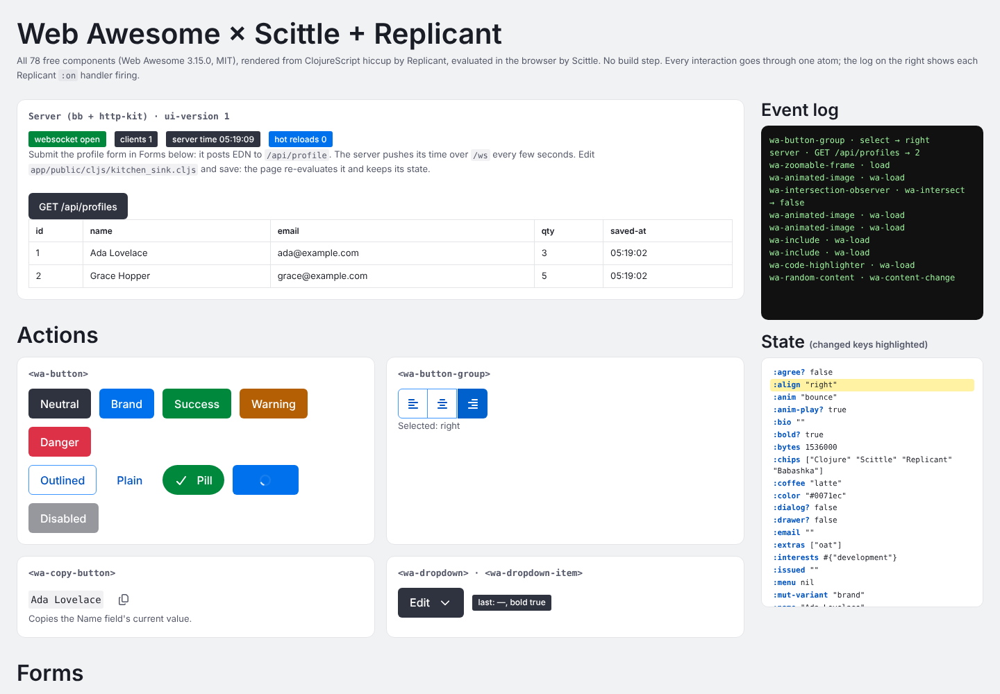

# Scittle × Replicant × Web Awesome — GUI kitchen sink

**Live demos:** [single file](https://franks42.github.io/scittle-replicant-webawesome-kitchensink/single-file/) · [HTML + separate .cljs](https://franks42.github.io/scittle-replicant-webawesome-kitchensink/app/public/static.html)  
**Guide:** [docs/GUIDE.md](docs/GUIDE.md) (also on the site: [GUIDE.html](https://franks42.github.io/scittle-replicant-webawesome-kitchensink/docs/GUIDE.html))

Browser UIs in ClojureScript **without React, a bundler, or a build step**:

- **[Scittle](https://github.com/babashka/scittle)** evaluates ClojureScript in the browser.
- **[Replicant](https://github.com/cjohansen/replicant)** renders hiccup to the DOM (loaded as a Scittle plugin).
- **[Web Awesome](https://webawesome.com)** provides the components: all 78 free ones (3.15.0, MIT) are exercised here.



## What this is (and isn't)

This is a **kitchen-sink demo**: one page that puts every free Web Awesome component on screen, wires each interactive one to a single ClojureScript atom, and logs every event it handles. Its job is to show, by running code, that the stack works and *how* each component is driven: which attribute to set, which event to listen for, where the value lives in the event.

It is **not a library and not a starter app you should ship as-is.** Treat it as a template you adapt once you understand it:

1. Run it, click around, and watch the **Event log** and **State** panels on the right (see below). Every interaction is a Replicant `:on` handler doing a `swap!` on one atom, and the two panels show you both halves of that.
2. Read `app/public/cljs/kitchen_sink.cljs` with the page open (see *What to look for* below).
3. Copy the parts you need into your own project and delete the rest (see *Using it as a template*).

## Watch the Event log and State panels

The two panels on the right are the best way to learn how the page works. Click, type or drag anything and watch both:

- **Event log** (newest first): which handler fired and with what value, e.g. `wa-button-group · select → right` or `wa-dialog · wa-hide`. That tells you which DOM event a component emits and what you read from it.
- **State** (one row per key, sorted): the whole app state, with the keys the last `swap!` changed **highlighted for two seconds**. That tells you exactly what your handler changed.

So every interaction shows the full loop: **event → handler → `swap!` → changed keys → re-render**. In the screenshot above, clicking the right-align button logged `select → right` and highlighted `:align "right"`.

Things you'll notice while the page sits idle are real state changes, not noise:

- In app mode `:srv` lights up every 5 s: that's the server pushing a `:tick` over the websocket.
- `:size` changes once right after load, when the resize-observer demo first measures its box.

Both panels are ordinary code you can keep in your own app while developing: `log!`, `state-panel` and `note-change!` in `kitchen_sink.cljs`.

## Architecture

```
 Browser                                                     Server (app mode only)
 ───────────────────────────────────────────────────         ───────────────────────────────
 HTML shell (index.html / static.html)                       app/server.clj  (babashka + http-kit)
   ├─ <link> Web Awesome CSS ─┐                                ├─ GET  /…            static files
   ├─ <script> WA autoloader ─┤ pinned jsdelivr URLs           ├─ POST /api/profile  EDN in/out
   ├─ <script> Scittle ───────┤ (no npm, no bundler)           ├─ GET  /api/profiles EDN out
   ├─ <script> Replicant plugin                                ├─ /ws  websocket: :tick, :reload
   └─ <script type="application/x-scittle"                     └─ watcher: .cljs changed → :reload
             src="cljs/kitchen_sink.cljs">
                 │
                 ▼  Scittle interprets the ClojureScript
   (defonce state (atom {...}))  ◄────────────────────────┐
                 │ add-watch → render!                    │ swap!
                 ▼                                        │
   (view @state) → hiccup → replicant.dom/render          │
                 │                                        │
                 ▼                                        │
   <wa-input> <wa-select> <wa-dialog> …  ── events ──► :on handlers
   (Web Awesome custom elements; Lit renders their
    insides in shadow DOM; your code never touches Lit)
```

- **One atom, one render loop.** All UI state is in `state`; `add-watch` re-renders the whole view on every change (and records which keys changed, for the State panel). Replicant diffs and updates only what changed in the DOM.
- **Views are plain functions returning hiccup.** No component framework, no lifecycle; `(view s)` is pure data in, data out.
- **Web Awesome components are just HTML elements.** Replicant sets their attributes/properties and attaches native listeners, so standard events (`input`, `change`) and custom ones (`wa-hide`, `wa-tab-show`, …) work the same way.
- **The server is optional.** The whole left column of the diagram runs on any static host; the bb server on the right adds an API, push messages and hot reload.

## The three modes

The same `kitchen_sink.cljs` runs in three ways. The HTML page picks the mode by setting `window.KS_MODE` before the Scittle script runs; the cljs reads it into `mode`, `single?` and `server?`:

| | **single** | **static** | **app** (default) |
|---|---|---|---|
| Page | `single-file/index.html` | `app/public/static.html` | `app/public/index.html` |
| How the cljs arrives | inlined in the HTML | fetched: `<script src="cljs/kitchen_sink.cljs">` | fetched, same file |
| Assets (images, include, page-demo) | embedded as `data:` URLs / `srcdoc` | relative files next to the page | relative files, served by bb |
| Needs | any static host | any static host | `bb dev` |
| Server features | none | none | EDN API, websocket push, hot reload |
| Use it to | hand someone one working file | keep the UI in a real `.cljs` file, host anywhere (e.g. GitHub Pages) | grow into a real web app |
| Live | [GitHub Pages](https://franks42.github.io/scittle-replicant-webawesome-kitchensink/single-file/) | [GitHub Pages](https://franks42.github.io/scittle-replicant-webawesome-kitchensink/app/public/static.html) | your machine / server |

`app/` is the source of truth. `single-file/index.html` is **generated** from it by `bb build-single` (inlines the cljs, embeds the assets); never edit it by hand. GitHub Pages serves this repo from `main`, so after changing `app/`, run `bb build-single` and commit the regenerated file to update the live demo.

## What to look for

In `app/public/cljs/kitchen_sink.cljs`, top to bottom:

| Where | What it shows |
|---|---|
| `mode`, `single?`, `server?`, `asset` | How one file adapts to three deliveries (mode flag + asset indirection). |
| `;; State + helpers`: `state`, `log!`, `on!`, `tile` | The single atom, the event log, a handler helper (`(on! :name tv)` = "store this field's value"), and a layout helper. |
| `;; Server integration`: `api!`, `post-profile!`, `connect!`, `reload-cljs!`, `server-tile` | Request/response with EDN over `fetch`, server push over one websocket, and hot reload via `scittle.core.eval_string`. **This is the part to grow into a real app.** |
| `;; Sections`: `actions`, `forms`, `feedback`, `layout`, `navigation`, `media`, `helpers` | One function per category, one tile per component. Copy the tile for the component you need: it shows the attributes to set and the event to handle. |
| `state-panel`, `note-change!` | The State panel: sorted keys, and the watcher that diffs old vs. new state to highlight what the last `swap!` changed. |
| `view`, `render!`, `add-watch` (bottom) | The whole render loop: a few lines. |

Patterns worth noticing as you read:

- `[:wa-select {:value … :on {:change …}} …]`: attributes and handlers live in one map; there is no adapter layer.
- `(tile …)` is a **function call**, not `[tile …]`: Replicant renders data, it has no component syntax (that's Reagent).
- `wa-otp-input` is deliberately **uncontrolled**; every other form control binds `:value` to state (see the comment in `forms`).
- Methods on components are called on the DOM node: `(.next (el "stepper"))`, `(.create (el "toast") …)`.
- `defonce` for `state` and the websocket is what makes hot reload keep its state.

[docs/GUIDE.md](docs/GUIDE.md) has the event cheat sheet for every component and the gotchas we hit while testing.

## Using it as a template

1. **Pick a delivery mode.** Static (`static.html`) if you only need a UI; app (`index.html` + `server.clj`) if you need an API or push; single file if you need one artifact to hand around.
2. **Keep the skeleton:** the HTML shell (pinned CDN links, icon registration), the mode/asset lines if you keep several modes, `state`, `log!`/`on!` if you like them, the Event log and State panels while you develop (`log!`, `state-panel`, `note-change!`), and the render loop at the bottom. In app mode also keep `api!`, `connect!`, `reload-cljs!` and `server.clj`.
3. **Delete the demo:** the seven section functions, `categories`, `tree-data`, `images`, `markdown-src`, the demo images, `include.html` and `page-demo.html`, and the profile routes in `server.clj`.
4. **Add your views** as plain functions over `state`, copying the tiles of the components you use from the kitchen sink.
5. **Add server routes** to `handler` in `server.clj` and call them with `api!`.
6. **Keep the versions pinned** (Web Awesome, Scittle, Font Awesome in the HTML) and bump them deliberately, together; re-run the tests when you do.

## Quick start

```bash
# App version: API + websocket + hot reload
bb dev                 # http://localhost:8090

# Single-file version
bb build-single        # regenerate single-file/index.html from app/
bb serve-single        # http://localhost:8091   (or: cd single-file && python3 -m http.server)

# HTML + separate .cljs, no server features
cd app/public && python3 -m http.server 8092    # http://localhost:8092/static.html
```

Requires [babashka](https://babashka.org). The browser loads Web Awesome, Scittle and Font Awesome icons from pinned jsdelivr URLs; no npm install. A page must be served over HTTP (`file://` won't load the ES modules).

## The app server in detail

`app/public/index.html` is a thin shell (CDN links, styles, `<div id="app">`) that loads the UI with
`<script type="application/x-scittle" src="cljs/kitchen_sink.cljs">`. `app/server.clj` (http-kit, built into babashka) adds:

- **`POST /api/profile`, `GET /api/profiles`**: the kitchen sink's profile form posts EDN; the server validates (blank name → 400), stores in `app/data/profiles.edn`, replies with EDN.
- **`/ws` websocket**: the server pushes `{:op :tick}` every 5 s (time and client count) to every browser.
- **Hot reload**: edit and save `app/public/cljs/kitchen_sink.cljs` → the server pushes `{:op :reload}` → the page re-evaluates the file with `scittle.core.eval_string`. State survives because it lives in `defonce` atoms. Try changing `ui-version`.

That's the skeleton of a real app: add routes to `handler` in `server.clj`, add views and `api!` calls in the cljs file.

## Layout

```
app/
  server.clj                  bb server: static files, EDN API, websocket, file watcher
  public/index.html           HTML shell (pinned CDN links, styles) - app mode
  public/static.html          same shell with KS_MODE "static" - no server features
  public/cljs/kitchen_sink.cljs   the whole UI: state atom, views, server integration
  public/img/, include.html, page-demo.html   demo assets
scripts/
  build_single.clj            app/ -> single-file/index.html (inline cljs, embed assets)
  serve_static.clj            tiny static server for single-file/
single-file/index.html        GENERATED - don't edit by hand
docs/GUIDE.md                 how to work with this stack (written for AI assistants; useful for humans)
test/
  kitchen_sink_test.py        63 interaction checks (Playwright), for any of the three versions
  server_test.py              17 checks: API, websocket, client count, hot reload, single-file and static modes
bb.edn                        tasks: dev, build-single, serve-single
```

## Tests

```bash
pip install playwright && playwright install chromium
bb dev & bb serve-single &
python3 test/kitchen_sink_test.py http://localhost:8090/index.html   # 63/63
python3 test/kitchen_sink_test.py http://localhost:8091/index.html   # 63/63
cd app/public && python3 -m http.server 8092 &
python3 test/kitchen_sink_test.py http://localhost:8092/static.html  # 63/63
python3 test/server_test.py                                          # 17/17
```

Optional env: `KS_CHROME=/path/to/chrome`, `KS_PROXY=http://host:port`.

## Things worth knowing

Full details and an event cheat sheet are in [docs/GUIDE.md](docs/GUIDE.md). The short version:

- Use Web Awesome's **`dist-cdn`** build; `dist` needs a bundler.
- In Replicant, **`[my-fn args]` is not a component call** (that's Reagent); write `(my-fn args)`.
- Bind `:value` to state for form controls, **except `wa-otp-input`**: keep it uncontrolled or typed digits are lost.
- Replicant attaches `:on` handlers natively, so `wa-*` custom events just work; no React adapter needed.
- Nine components are marked experimental in Web Awesome 3.15.0 (carousel, code highlighter, counter, lightbox, markdown, number ticker, tag input, and the carousel and lightbox items).

## Credits

Components: Web Awesome (MIT). Icons: Font Awesome Free. Images in `app/public/img/` were generated for this demo.

## License

This project: [EPL-2.0](LICENSE). Web Awesome is MIT; Font Awesome Free icons are CC BY 4.0 (icons) / MIT (code); both are loaded from jsdelivr, not vendored.
